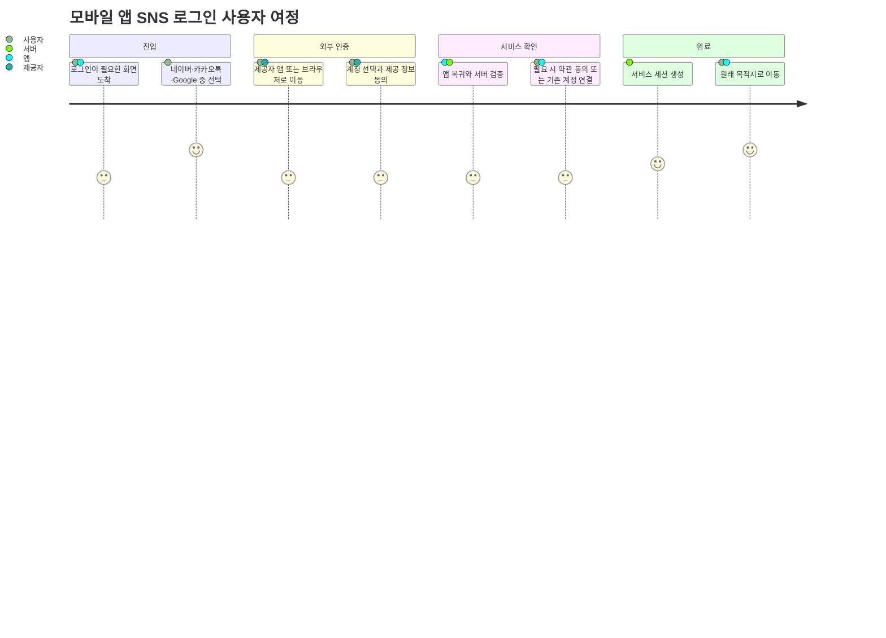
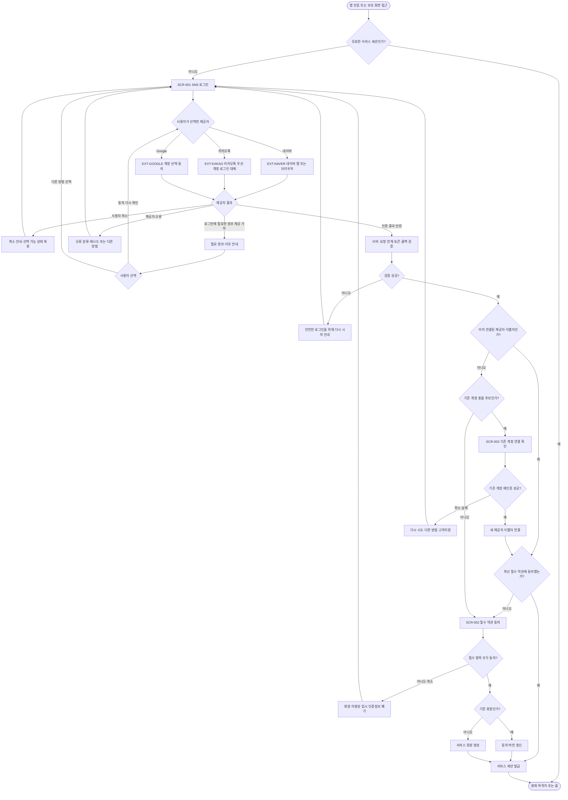
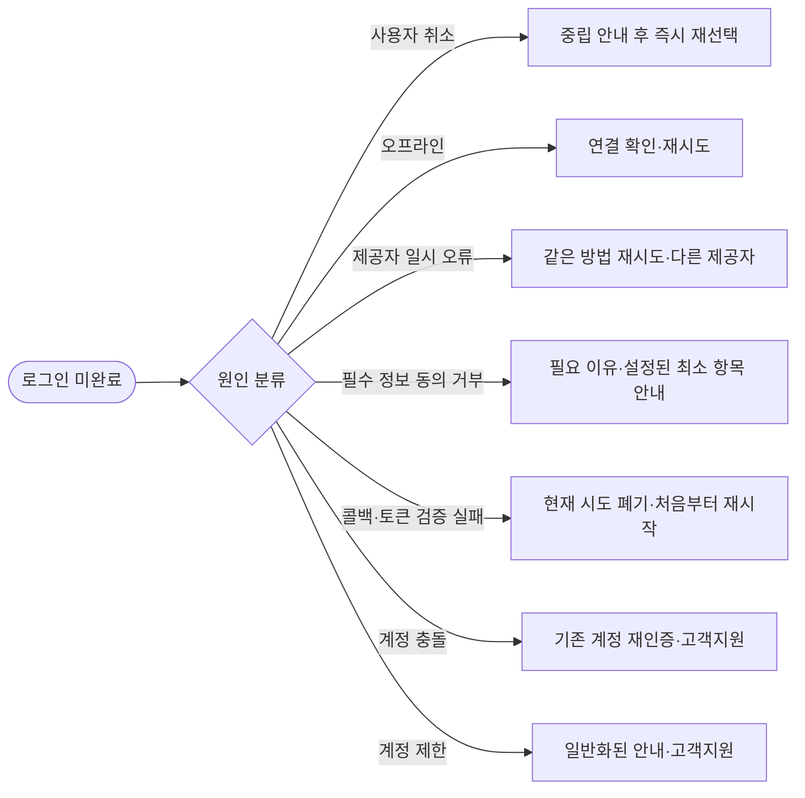

# 모바일 앱 SNS 로그인 화면설계서

## 0. 문서 제어

| 항목 | 내용 |
|---|---|
| 목적 | 네이버·카카오톡·Google을 사용하는 모바일 앱 로그인 여정을 기획·디자인·개발·QA가 동일하게 구현할 수 있도록 정의 |
| 대상 플랫폼 | iOS·Android 동시 지원 권장안. 실제 지원 OS와 최소 버전은 미결정 |
| 앱 소유 화면 | `SCR-001` SNS 로그인, `SCR-002` 필수 약관 동의, `SCR-003` 기존 계정 연결 확인 |
| 외부 화면 | 네이버·카카오·Google의 계정 선택·인증·동의 화면. 제공자가 소유하며 앱 화면설계 범위 밖 |
| 문서 상태 | 화면·상태·정책 권장안 작성 완료. 제품명, 법무 문구, 세션 수명, iOS 로그인 심사 예외 여부는 승인 필요 |
| 기준일 | 2026-08-12 |

### 상태 표기

- **확정**: 에던님 요청 또는 현재 프로젝트 원본에서 확인된 사항
- **권장안**: 제품 원본이 없어 안전성·일관성 기준으로 제안한 Dex inference
- **미결정**: 제품 책임자의 선택이 필요한 사항
- **미확인**: 실제 앱·사업자 콘솔·법무·서버에서 검증하지 못한 사항
- **source-backed**: 연결된 공식 문서가 직접 뒷받침하는 내용

## 1. 목표와 비목표

### 1.1 목표

1. 사용자가 네이버, 카카오톡, Google 중 원하는 방법으로 로그인을 시작할 수 있습니다.
2. 앱 이탈, 제공자 취소, 동의 거부, 네트워크 오류, 서버 검증 실패 후에도 현재 맥락을 잃지 않고 복구할 수 있습니다.
3. 기존 회원, 신규 회원, 계정 충돌 사용자를 안전하게 분기합니다.
4. 필수 약관과 선택 동의를 분리하고, 최소 정보 수집과 계정 삭제·연동 해제까지 고려합니다.
5. 화면 설명, 정책, 상태, 오류 문구, 수용 기준, 추적성을 한 문서에서 제공합니다.

### 1.2 비목표

- 이메일·비밀번호 로그인, 휴대폰 인증, 비밀번호 재설정
- 온보딩 프로필 입력, 홈 화면 상세 설계
- 각 사업자 개발자 콘솔 등록과 SDK 코드 구현
- 실제 이용약관·개인정보 처리방침 법률 문안 작성
- 회원 탈퇴 화면의 상세 UI. 단, 로그인 정책과 연결되는 요구사항은 정의

## 2. 입력 근거와 신뢰 수준

| ID | 근거 | 확인 내용 | 분류 |
|---|---|---|---|
| SRC-001 | 에던님 요청, 2026-08-12 | 모바일 앱 로그인, 네이버·카카오톡·Google 사용, 상세 description·정책·flow chart 필요 | 확정 |
| SRC-002 | `DexCompany-Ops/PRD.md`, `SPEC.md`, `SCREEN_FLOW.md` | 제목만 있고 제품 요구사항 본문은 비어 있음 | 미확인 근거의 부재 |
| SRC-003 | Dex Company LLM Wiki 검색 | 로그인·소셜 로그인·OAuth·계정 연결 질의를 검색했으나 이 기능에 직접 적용 가능한 노트 없음 | checked, no applicable evidence |
| SRC-004 | [Android Sign in with Google](https://developer.android.com/identity/sign-in/credential-manager-siwg) | Android는 Credential Manager의 Google 로그인과 지속 노출 버튼을 함께 권장 | source-backed |
| SRC-005 | [Google Sign-In for iOS](https://developers.google.com/identity/sign-in/ios/start-integrating) | iOS 앱·백엔드 OAuth client와 콜백 구성이 필요 | source-backed |
| SRC-006 | [Google ID token 서버 검증](https://developers.google.com/identity/gsi/web/guides/verify-google-id-token) | 서버에서 서명·aud·iss·exp를 검증하고 `sub`를 사용자 식별자로 사용하며 이메일을 식별자로 쓰지 않음 | source-backed |
| SRC-007 | [카카오 로그인 Android](https://developers.kakao.com/docs/ko/kakaologin/android), [iOS](https://developers.kakao.com/docs/ko/kakaologin/ios) | 카카오톡 로그인을 권장하고 미설치·미지원 환경에는 카카오계정 브라우저 로그인을 제공할 수 있으며 취소·오류 처리가 필요 | source-backed |
| SRC-008 | [카카오 로그인 REST API](https://developers.kakao.com/docs/ko/kakaologin/rest-api) | 사용자 동의, 인가 코드, `state`·`nonce`, 서비스 회원 판별·가입 처리는 서비스가 구현 | source-backed |
| SRC-009 | [네이버 로그인 iOS](https://developers.naver.com/docs/login/ios/) | 네이버 앱 우선·브라우저 fallback, 콜백, 로그아웃·연동 해제·재인증 흐름 제공 | source-backed |
| SRC-010 | [Apple App Review Guidelines 4.8](https://developer.apple.com/app-store/review/guidelines/) | 제3자 소셜 로그인으로 주 계정을 만들면 예외가 아닌 경우 동등한 추가 로그인 서비스가 필요 | source-backed |
| SRC-011 | [Apple 접근성 HIG](https://developer.apple.com/design/human-interface-guidelines/accessibility), [Android 터치 영역](https://developer.android.com/guide/topics/ui/accessibility/views/apps-views) | iOS 44×44pt, Android 48×48dp 이상의 상호작용 영역 권장 | source-backed |
| SRC-012 | [개인정보 보호법 제15조](https://www.law.go.kr/lsLinkCommonInfo.do?chrClsCd=010202&lsJoLnkSeq=1029335387), [제30조](https://law.go.kr/lsLinkCommonInfo.do?chrClsCd=010202&lsJoLnkSeq=1020398435) | 개인정보 수집·이용의 적법 근거·동의와 개인정보 처리방침 수립·공개를 구분 | source-backed |

> Wiki 본문은 검색 결과가 없어 이번 설계 판단의 근거로 사용하지 않았습니다. 제품 정책이 Wiki에 승격되면 본 문서의 권장안을 교체해야 합니다.

## 3. 범위, 가정, 열린 결정

### 3.1 확정 범위

- 모바일 앱의 로그인 진입점을 설계합니다.
- 로그인 제공자는 네이버, 카카오톡, Google 세 가지입니다.
- 정상·취소·실패·오프라인·계정 충돌·신규 약관 동의를 포함합니다.
- 사용자 여정과 분기 흐름을 Mermaid로 제공합니다.

### 3.2 권장 가정

| ID | 가정 | 영향 |
|---|---|---|
| A-001 | iOS와 Android를 모두 지원합니다. | OS별 SDK, 콜백, 심사 정책을 모두 고려 |
| A-002 | 로그인은 서비스의 핵심 기능 접근 전에 필요합니다. | `SCR-001`에 닫기 버튼은 기본 미노출. 로그인 없이 이용 가능하면 닫기 버튼 추가 |
| A-003 | 버튼 순서는 요청에 제시된 네이버 → 카카오톡 → Google을 임시 적용합니다. | 실제 전환 데이터나 사업 우선순위 확정 후 변경 가능 |
| A-004 | 최초 SNS 인증은 필수 약관 동의 후 서비스 계정을 생성합니다. | 인증 성공만으로 회원 데이터가 생성되지 않음 |
| A-005 | 이메일 일치만으로 계정을 자동 연결하지 않습니다. | 계정 탈취를 막기 위해 기존 계정 재인증 필요 |
| A-006 | 로그인 후 목적지는 보호 화면의 원래 위치이며, 원래 위치가 없으면 홈입니다. | 딥링크와 세션 만료 복귀 맥락 보존 필요 |
| A-007 | 사업자 인증 화면은 공식 SDK 또는 시스템 브라우저가 제공합니다. | 앱이 사업자 ID·비밀번호를 직접 수집하지 않음 |

### 3.3 열린 결정

| ID | 결정 필요 항목 | 권장 기본안 | 확정 전 위험 |
|---|---|---|---|
| Q-001 | 실제 제품명, 로고, 로그인 후 기본 목적지 | 제품 홈을 기본 목적지로 사용 | 최종 카피·브랜드 적용 불가 |
| Q-002 | iOS에서 Apple 심사 규정 4.8 예외 해당 여부 | PO와 법무/출시 책임자가 근거를 승인하며, 예외가 아니면 동등한 Apple 로그인 옵션 추가 | 근거 승인 또는 옵션 반영 전 iOS 출시 차단 |
| Q-003 | 필수 이용약관, 개인정보 수집·이용 동의, 개인정보 처리방침 URL, 선택 동의, 적용 버전 | 수집·이용 동의와 처리방침 공개 링크를 분리 | 법무 효력·가입 완료 기준 미확정 |
| Q-004 | 만 14세 미만 또는 연령 제한 정책 | 연령 제한이 있으면 가입 전 검증 단계 추가 | 미성년자 처리 누락 가능 |
| Q-005 | 동일인·중복 계정·탈퇴 계정 연결 정책 | 자동 연결 금지, 기존 계정 재인증 후 연결 | 중복 회원 또는 계정 탈취 위험 |
| Q-006 | 세션 유지 기간과 민감 행위 재인증 기준 | access 15분, refresh 30일, 절대 90일을 보안 검토용 초안으로 사용 | 제품 민감도에 맞지 않을 수 있음 |
| Q-007 | 사업자별 요청 scope와 개발자 콘솔 검수 상태 | 식별에 필요한 최소 scope만 요청 | 심사 지연·불필요 정보 수집 위험 |
| Q-008 | 로그인 없이 둘러보기 허용 여부 | 핵심 기능에 계정이 필요하면 미허용 | 닫기·뒤로가기 정책 변경 필요 |

## 4. 사용자·시스템 경계

| 주체 | 책임 |
|---|---|
| 사용자 | 로그인 방법 선택, 사업자 계정 인증·동의, 서비스 약관 동의, 계정 연결 재인증 |
| 모바일 앱 | 선택 UI, 외부 인증 시작, 진행·오류 상태, 안전한 콜백 전달, 목적지 복귀 |
| 서비스 백엔드 | auth attempt 검증, 토큰/인가 코드 서버 검증, 회원 조회·생성·연결, 서비스 세션 발급, 감사 이벤트 기록 |
| 로그인 제공자 | 계정 선택, 자격 증명 입력, 제공자 동의, 인증 결과 반환 |
| 고객지원 | 계정 접근 불가·중복·제재·탈퇴 후 재가입 예외 처리 |

### 4.1 보안 경계

- 앱은 네이버·카카오·Google 비밀번호를 입력받거나 저장하지 않습니다.
- 제공자 토큰과 인가 코드는 UI, 분석 이벤트, 일반 로그, 오류 메시지에 노출하지 않습니다.
- 클라이언트가 전달한 사용자 ID를 그대로 신뢰하지 않고 서버가 제공자 서명·대상·발급자·만료·요청 연계를 검증합니다.
- 서비스 회원 식별 키는 `provider + 검증된 provider subject`입니다. 이메일은 연락·후보 탐색 정보일 뿐 기본키나 자동 연결 근거가 아닙니다.

## 5. 기능 요구사항

| ID | 요구사항 | 우선순위 | 근거/상태 |
|---|---|---|---|
| RQ-001 | 로그인 화면에 네이버·카카오톡·Google 선택지를 모두 노출합니다. | Must | SRC-001, 확정 |
| RQ-002 | 각 버튼은 제공자명, 공식 브랜드 자산, 명확한 접근성 이름을 가집니다. | Must | source-backed |
| RQ-003 | 선택한 제공자의 공식 앱·SDK·시스템 브라우저 인증으로 전환하고 안전하게 앱으로 복귀합니다. | Must | source-backed |
| RQ-004 | 사용자가 외부 인증을 취소하거나 뒤로 가면 오류가 아닌 취소 상태로 원래 로그인 화면에 복귀합니다. | Must | source-backed |
| RQ-005 | 요청 진행 중 중복 탭을 차단하고 현재 단계와 복구 행동을 보여줍니다. | Must | Dex inference |
| RQ-006 | 인증 결과는 백엔드에서 검증한 뒤에만 서비스 세션으로 교환합니다. | Must | source-backed |
| RQ-007 | 이미 연결된 제공자 식별자는 기존 회원으로 로그인시킵니다. | Must | Dex inference |
| RQ-008 | 신규 사용자는 필수 약관 동의가 완료된 뒤에만 회원을 생성합니다. | Must | Dex inference, Q-003 |
| RQ-009 | 이메일 등 프로필 일치만으로 자동 계정 연결하지 않고 기존 계정 재인증을 요구합니다. | Must | Dex inference, Q-005 |
| RQ-010 | 오프라인, 제공자 오류, 서버 오류, 유효하지 않은 콜백, 계정 제한을 서로 다른 복구 흐름으로 처리합니다. | Must | Dex inference |
| RQ-011 | 서비스 세션 만료 후 로그인하면 원래 보호 화면으로 복귀합니다. | Should | A-006 |
| RQ-012 | 화면 읽기, 큰 글자, 명도 대비, 포커스, 최소 터치 영역을 지원합니다. | Must | source-backed |
| RQ-013 | 필수·선택 동의를 분리하고 선택 동의를 기본 체크하지 않으며 개인정보 처리방침은 별도 공개 링크로 제공합니다. | Must | SRC-012 + Dex inference, Q-003 |
| RQ-014 | 계정 생성 기능의 출시 전, 별도 계정관리 사양에서 로그아웃·제공자 연동 해제·회원 탈퇴를 서로 다른 동작으로 정의합니다. | Release gate, 후속 범위 | source-backed + Dex inference |
| RQ-015 | 원시 제공자 오류·개인정보·토큰 없이 최소 분석 이벤트를 수집합니다. | Should | Dex inference |
| RQ-016 | iOS 출시 전에 Apple 로그인 서비스 규정 충족 또는 예외 근거를 승인받습니다. | Must | SRC-010, Q-002 |
| RQ-017 | 제공자 앱 미설치·미지원 시 가능한 공식 브라우저 또는 계정 선택 대체 경로를 제공합니다. | Must | source-backed |
| RQ-018 | 계정 연결 실패·기존 계정 접근 불가 시 안전한 고객지원 경로를 제공합니다. | Should | Dex inference |

## 6. 화면 목록

| 화면 ID | 화면명 | 소유 | 진입 조건 | 완료 조건 |
|---|---|---|---|---|
| SCR-001 | SNS 로그인 | 앱 | 비로그인, 세션 만료, 로그아웃, 보호 화면 진입 | 인증 검증 후 분기 또는 취소·실패 복구 |
| SCR-002 | 필수 약관 동의 | 앱 | 신규 회원 또는 필수 약관 버전 갱신 회원 | 필수 항목 동의 저장 후 회원 생성/세션 발급 |
| SCR-003 | 기존 계정 연결 확인 | 앱 | 새 제공자 식별자와 기존 회원 후보가 충돌 | 기존 계정 재인증 후 연결 또는 안전하게 중단 |
| EXT-NAVER | 네이버 인증·동의 | 네이버 | 네이버 버튼 선택 | 취소·실패 또는 콜백 반환 |
| EXT-KAKAO | 카카오톡/카카오계정 인증·동의 | 카카오 | 카카오톡 버튼 선택 | 취소·실패 또는 콜백 반환 |
| EXT-GOOGLE | Google 계정 선택·동의 | Google/OS | Google 버튼 선택 | 취소·실패 또는 credential 반환 |

## 7. 사용자 여정 한눈에 보기



### 여정별 사용자 기대와 설계 대응

| 단계 | 사용자 질문 | 설계 대응 |
|---|---|---|
| 로그인 선택 | “어떤 계정으로 들어갈 수 있지?” | 세 제공자를 동일 계층의 전체 폭 버튼으로 명확히 노출 |
| 외부 이동 | “앱을 벗어나도 괜찮나?” | 버튼 직후 진행 상태, 공식 제공자 UI, 안전한 복귀 처리 |
| 동의 | “무슨 정보가 제공되지?” | 제공자 동의는 제공자 화면, 서비스 약관은 앱 화면에서 분리 |
| 검증 | “멈춘 건가?” | 앱 복귀 즉시 `로그인 확인 중` 상태와 중복 입력 차단 |
| 예외 | “왜 안 됐고 다음에 뭘 하지?” | 취소·오프라인·일시 오류·보안 오류별 한 문장 설명과 단일 복구 행동 |
| 완료 | “원래 하려던 곳으로 돌아가나?” | 보호 화면 맥락을 보존하고 성공 후 한 번만 이동 |

## 8. 전체 Flow Chart



### 실패·권한·네트워크 분기 원칙



## 9. 공통 레이아웃·상호작용 규칙

### 9.1 레이아웃

- 모든 화면은 상단 안전 영역, 스크롤 가능한 본문, 하단 안전 영역을 준수합니다.
- 휴대폰에서는 좌우 24dp/pt 기준 여백을 권장하고, 작은 화면에서는 최소 16dp/pt까지 축소합니다.
- 태블릿은 콘텐츠 열 최대 480dp/pt의 중앙 정렬 카드형 레이아웃을 권장합니다.
- 세로 공간이 부족하거나 큰 글자를 사용하면 버튼과 법적 링크가 잘리지 않도록 전체 본문을 스크롤합니다.
- 배경 이미지나 장식은 로그인 이해를 방해하지 않으며 장식 요소는 접근성 트리에서 제외합니다.

### 9.2 공통 컴포넌트

| 컴포넌트 | 규칙 |
|---|---|
| 상단 탐색 | 로그인 필수이면 뒤로/닫기 미노출. 선택 로그인일 때만 `닫기` 제공 |
| 제목 | 화면마다 하나의 명확한 H1 역할. 큰 글자에서 2줄 허용 |
| 설명 | 다음 행동과 데이터 처리 맥락을 1~2문장으로 설명 |
| 주요 버튼 | 전체 폭, 제공자명 포함, 로고만 단독 사용 금지 |
| 진행 표시 | 선택한 버튼 내부 또는 화면 중앙 오버레이. 스크린리더에 상태 알림 |
| 오류 안내 | 제목 아래 인라인 배너 우선. 원인과 다음 행동을 함께 제공 |
| 법적 링크 | 이용약관·개인정보 처리방침을 독립 링크로 제공하고 새 화면 진입 후 복귀 가능 |
| 고객지원 | 반복 실패·계정 접근 불가 상황에서만 강조하고 평상시에는 보조 링크 |

### 9.3 공통 네비게이션

- 인증 시작 전 `return destination`을 앱 내부 allowlist route로 저장합니다.
- 외부 콜백의 임의 URL을 목적지로 사용하지 않습니다.
- 성공 후 목적지 이동은 한 번만 실행하고 뒤로가기로 로그인 처리 화면에 돌아오지 않게 교체 탐색합니다.
- 앱이 외부 인증 중 종료되어도 미완료 요청은 안전하게 폐기하고 `SCR-001` 기본 상태에서 재개합니다.

## 10. 화면 상세

### 10.1 SCR-001 — SNS 로그인

#### 화면 목적

사용자가 지원되는 로그인 제공자를 이해하고 한 번의 선택으로 안전한 외부 인증을 시작하게 합니다.

#### 진입·이탈

| 항목 | 정의 |
|---|---|
| 진입 | 첫 실행의 계정 필요 시점, 보호 화면 접근, 세션 만료, 명시적 로그아웃 |
| 정상 이탈 | 제공자 화면 → 서버 검증 → 목적지, `SCR-002`, 또는 `SCR-003` |
| 비정상 이탈 | 사용자 취소·제공자 오류·검증 오류 시 같은 화면의 복구 상태 |
| 뒤로가기 | 로그인 필수 진입은 앱 종료/이전 공개 화면 정책을 따름. 로그인 선택 진입은 이전 화면 복귀 |

#### 제안 카피

| 영역 | 카피 | 상태 |
|---|---|---|
| 제목 | `로그인하고 시작하세요` | 권장안 |
| 설명 | `네이버, 카카오톡 또는 Google 계정으로 간편하게 로그인할 수 있어요.` | 권장안 |
| 네이버 버튼 | `네이버로 계속하기` | 권장안, 공식 최신 BI 확인 필요 |
| 카카오 버튼 | `카카오톡으로 계속하기` | 권장안, 공식 최신 BI 확인 필요 |
| Google 버튼 | 공식 SDK·브랜드 가이드가 허용하는 한국어 로그인 문구 | source-backed, 최종 문자열 미확인 |
| 약관 보조문 | `처음 이용하시는 경우 로그인 후 필수 약관 동의가 진행됩니다.` | 권장안 |
| 지원 링크 | `로그인에 문제가 있나요?` | 권장안 |

#### 저충실도 와이어프레임

```text
┌──────────────────────────────┐
│          Safe area           │
│                              │
│          서비스 로고          │
│                              │
│     로그인하고 시작하세요      │
│ 네이버, 카카오톡 또는 Google   │
│ 계정으로 간편하게 로그인…      │
│                              │
│ [ N  네이버로 계속하기       ] │
│ [ K  카카오톡으로 계속하기    ] │
│ [ G  Google 공식 로그인 버튼 ] │
│                              │
│ 처음 이용 시 필수 약관 동의…   │
│ 이용약관 · 개인정보 처리방침    │
│                              │
│      로그인에 문제가 있나요?    │
└──────────────────────────────┘
```

#### 요소 정의

| 요소 ID | 요소 | Description | 기본 상태 | 동작/시스템 반응 |
|---|---|---|---|---|
| LGN-01 | 서비스 로고 | 로그인 대상 서비스를 식별 | 표시 | 탭 동작 없음, 장식이면 접근성 트리 제외 |
| LGN-02 | 제목 | 사용자의 현재 과업을 선언 | 표시 | 큰 글자에서 줄바꿈 허용 |
| LGN-03 | 설명 | 지원 제공자와 로그인 목적 안내 | 표시 | 제공자 목록과 실제 버튼이 일치해야 함 |
| LGN-04 | 네이버 버튼 | 네이버 인증 시작 | 활성 | 탭 즉시 모든 제공자 버튼 잠금, 네이버 SDK/브라우저 호출 |
| LGN-05 | 카카오톡 버튼 | 카카오 로그인 시작 | 활성 | 카카오톡 사용 가능 시 앱 우선, 불가 시 공식 계정 로그인 fallback |
| LGN-06 | Google 버튼 | Google 로그인 시작 | 활성 | Android Credential Manager 또는 iOS Google Sign-In 호출 |
| LGN-07 | 진행 상태 | 제공자 실행·앱 복귀 후 검증 상태 전달 | 숨김 | `로그인 화면을 여는 중` → `로그인을 확인하는 중` 순으로 알림 |
| LGN-08 | 오류 배너 | 복구 가능한 오류 설명 | 숨김 | 문구와 `다시 시도` 또는 `다른 방법 선택` 제공 |
| LGN-09 | 법적 링크 | 서비스 약관 원문 열기 | 활성 | 앱 내 웹뷰/브라우저 후 동일 로그인 상태로 복귀 |
| LGN-10 | 고객지원 | 반복 실패·계정 접근 불가 지원 | 활성 | 개인정보 없는 오류 참조번호만 전달 가능 |

#### 상태 정의

| 상태 | 화면 표현 | 허용 행동 | 종료 조건 |
|---|---|---|---|
| Default | 세 버튼 활성, 오류 없음 | 제공자 선택, 법적 링크, 지원 | 버튼 탭 |
| Launching | 선택 버튼 spinner, 세 버튼 비활성 | 접근성 취소가 필요한 경우 시스템 뒤로가기만 허용 | 외부 UI 표시 또는 시작 실패 |
| External Auth | 앱이 background | 제공자 UI에서 선택·취소 | 앱 복귀 |
| Verifying | 전체 진행 표시, 버튼 비활성 | 중복 요청 금지 | 서버 성공·실패 |
| Cancelled | 중립 배너, 세 버튼 활성 | 같은/다른 제공자 재선택 | 새 선택 또는 화면 이탈 |
| Offline | 오프라인 배너, `다시 시도` | 연결 복구 후 재시도 | 네트워크 확인 성공 |
| Recoverable Error | 일반화된 오류와 재시도 | 재시도, 다른 제공자, 지원 | 새 요청 |
| Security Error | `안전한 로그인을 위해 다시 시작` | 처음부터 재시도 | 새 auth attempt |
| Maintenance | 서비스 일시 이용 불가, 재시도/공지 | 재시도, 공지 확인 | 서버 정상화 |

#### SCR-001 수용 기준

- **AC-LGN-001** Given 사용자가 비로그인 상태일 때, When `SCR-001`이 열리면, Then 네이버·카카오톡·Google 세 버튼이 모두 식별 가능한 텍스트와 함께 보입니다.
- **AC-LGN-002** Given 버튼이 활성일 때, When 한 제공자를 연속 탭하면, Then 하나의 auth attempt만 생성되고 모든 제공자 버튼은 검증 완료까지 비활성화됩니다.
- **AC-LGN-003** Given 카카오톡을 사용할 수 없을 때, When 카카오 로그인을 선택하면, Then 공식 카카오계정 로그인 대체 경로가 열립니다.
- **AC-LGN-004** Given 사용자가 제공자 화면을 취소했을 때, When 앱으로 돌아오면, Then 실패로 낙인찍지 않는 취소 안내와 세 제공자 선택지가 다시 활성화됩니다.
- **AC-LGN-004A** Given 로그인에 반드시 필요한 최소 정보 제공이 거부됐고 제공자가 이를 구분해 반환했을 때, When 앱으로 돌아오면, Then 취소 문구로 합치지 않고 필요한 정보와 이유, 재동의 또는 다른 로그인 방법을 안내합니다.
- **AC-LGN-005** Given 앱이 오프라인일 때, When 로그인 버튼을 누르면, Then 외부 인증을 시작하지 않고 연결 확인과 재시도 행동을 안내합니다.
- **AC-LGN-006** Given 유효하지 않은 콜백이 도착했을 때, When 서버 검증이 실패하면, Then 세션을 발급하지 않고 현재 시도를 폐기한 뒤 처음부터 재시작하도록 안내합니다.
- **AC-LGN-007** Given 스크린리더가 켜져 있을 때, When 진행 상태가 바뀌면, Then 선택한 제공자와 현재 상태가 한 번만 읽힙니다.
- **AC-LGN-008** Given 큰 글자와 320폭 화면일 때, When 화면을 표시하면, Then 제목·버튼·법적 링크가 잘리거나 겹치지 않고 스크롤로 접근됩니다.

### 10.2 SCR-002 — 필수 약관 동의

#### 화면 목적

신규 회원 또는 약관 갱신 대상자가 서비스 가입·이용에 필요한 동의를 명시적으로 완료하게 합니다. 제공자 정보 제공 동의와 서비스 자체 약관 동의를 혼합하지 않습니다.

#### 진입·이탈

| 항목 | 정의 |
|---|---|
| 진입 | 제공자 검증 성공 후 신규 회원, 또는 최신 필수 약관 미동의 기존 회원 |
| 정상 이탈 | 동의 저장 → 회원 생성/동의 버전 갱신 → 세션 발급 → 목적지 |
| 취소 | 서비스 회원 미생성, 임시 인증정보 폐기, `SCR-001` 복귀 |
| 오류 | 문서 로드·제출 실패 시 동의 상태를 보존하고 재시도 |

#### 제안 카피

| 영역 | 카피 | 상태 |
|---|---|---|
| 제목 | `서비스 이용을 위해 동의해 주세요` | 권장안 |
| 설명 | `필수 항목에 동의하면 가입과 로그인이 완료됩니다.` | 권장안 |
| 전체 선택 | `전체 동의` | 권장안, 선택 동의까지 포함함을 부가 설명 |
| CTA | `동의하고 계속하기` | 권장안 |
| 취소 | `로그인 취소` | 권장안 |

#### 저충실도 와이어프레임

```text
┌──────────────────────────────┐
│ ‹  약관 동의                  │
│                              │
│ 서비스 이용을 위해 동의해 주세요 │
│ 필수 항목에 동의하면 가입과…    │
│                              │
│ [ ] 전체 동의                 │
│ ──────────────────────────── │
│ [ ] (필수) 서비스 이용약관  >  │
│ [ ] (조건부) 개인정보 수집·이용 >│
│ [ ] (선택) 마케팅 정보 수신  >  │
│     개인정보 처리방침 보기        │
│                              │
│ [      동의하고 계속하기      ] │
│          로그인 취소           │
└──────────────────────────────┘
```

#### 요소·필드 정책

| 요소 ID | 요소 | 정책 |
|---|---|---|
| AGR-01 | 전체 동의 | 필수·선택을 한 번에 토글할 수 있으나 선택 동의가 필수가 된 것처럼 표현하지 않음. 해제 시 모두 해제 |
| AGR-02 | 필수 이용약관 | 기본 미선택. 제목·필수 표기·상세 보기·버전 제공 |
| AGR-03 | 조건부 개인정보 수집·이용 동의 | 법무가 동의를 적법 근거로 확정한 경우에만 필수·기본 미선택으로 표시. 수집 항목·목적·보유 기간·거부권과 불이익을 제공. 다른 적법 근거가 적용되면 체크박스로 가입을 차단하지 않음 |
| AGR-04 | 선택 동의 | 기본 미선택. 거부해도 가입 가능. 실제 항목은 Q-003 확정 후 구성 |
| AGR-05 | 계속 CTA | 모든 필수 항목 선택 전 비활성. 제출 중 중복 탭 차단 |
| AGR-06 | 로그인 취소 | 회원을 생성하지 않고 임시 인증 컨텍스트를 폐기 |
| AGR-07 | 개인정보 처리방침 | 동의 체크박스와 분리된 상시 공개 링크. 상세 확인 후 선택 상태를 보존하고 복귀 |

#### 상태·예외

| 상태 | 처리 |
|---|---|
| 약관 로딩 | skeleton 또는 진행 표시. CTA 비활성 |
| 약관 로드 실패 | `약관을 불러오지 못했어요`와 재시도. 동의 추정 금지 |
| 필수 미동의 | CTA 비활성. 버튼 탭 후 오류를 내는 방식보다 사전 제약을 우선 |
| 제출 중 | 선택 잠금, `동의를 저장하는 중` 알림 |
| 버전 충돌 | 최신 문서를 다시 표시하고 변경 사실 안내 후 재동의 |
| 제출 실패 | 선택 상태 유지, 일반 오류와 재시도 제공 |
| 오프라인 | 선택은 가능하되 제출 시 연결 확인 안내. 서버 저장 전 완료 처리 금지 |

#### SCR-002 수용 기준

- **AC-AGR-001** Given 신규 사용자가 약관 화면에 진입했을 때, Then 필수와 선택 항목은 모두 기본 미선택입니다.
- **AC-AGR-002** Given 선택 항목만 거부했을 때, When 필수 항목을 모두 동의하면, Then 계속 CTA가 활성화되고 가입할 수 있습니다.
- **AC-AGR-003** Given 필수 항목이 하나라도 미동의일 때, Then 회원 생성 API를 호출할 수 없습니다.
- **AC-AGR-004** Given 사용자가 상세 약관을 열었다 돌아왔을 때, Then 이전 선택 상태와 스크롤 맥락이 유지됩니다.
- **AC-AGR-005** Given 제출 중 약관 버전이 변경됐을 때, Then 이전 버전을 동의 완료로 기록하지 않고 최신 버전을 다시 확인하게 합니다.
- **AC-AGR-006** Given 사용자가 로그인을 취소했을 때, Then 서비스 회원과 서비스 세션을 생성하지 않고 임시 인증정보를 폐기합니다.
- **AC-AGR-007** Given 사용자가 동의 여부와 무관하게 개인정보 처리방침 링크를 선택했을 때, Then 처리방침이 열리고 돌아오면 기존 약관 선택 상태가 유지됩니다.

### 10.3 SCR-003 — 기존 계정 연결 확인

#### 화면 목적

새 제공자 로그인 결과가 기존 서비스 계정과 충돌할 가능성이 있을 때 이메일만으로 자동 병합하지 않고 기존 계정의 소유권을 재확인합니다.

#### 진입·이탈

| 항목 | 정의 |
|---|---|
| 진입 | 검증된 새 제공자 식별자가 기존 계정 후보와 충돌하나 아직 연결되지 않음 |
| 정상 이탈 | 기존 연결 제공자로 재인증 → 동일 회원 확인 → 새 제공자 연결 → 약관/목적지 |
| 중단 | 재인증 취소·실패 → `SCR-001` 또는 고객지원 |
| 금지 | 이메일 일치만으로 자동 연결, 계정 존재 여부를 과도하게 노출, 현재 제공자 토큰 재사용만으로 연결 |

#### 제안 카피

| 영역 | 카피 | 상태 |
|---|---|---|
| 제목 | `기존 계정 확인이 필요해요` | 권장안 |
| 설명 | `계정을 안전하게 연결하려면 이전에 사용한 로그인 방법으로 한 번 더 확인해 주세요.` | 권장안 |
| 주 CTA | `기존 계정으로 확인하기` | 권장안 |
| 보조 CTA | `다른 로그인 방법 선택` | 권장안 |
| 지원 | `기존 계정에 접근할 수 없나요?` | 권장안 |

#### 저충실도 와이어프레임

```text
┌──────────────────────────────┐
│ ‹  계정 확인                  │
│                              │
│       계정 보호 아이콘         │
│ 기존 계정 확인이 필요해요       │
│ 계정을 안전하게 연결하려면…     │
│                              │
│ [   기존 계정으로 확인하기    ] │
│ [   다른 로그인 방법 선택     ] │
│                              │
│   기존 계정에 접근할 수 없나요? │
└──────────────────────────────┘
```

#### 연결 정책

1. 화면에는 기존 계정의 전체 이메일·전화번호·실명 등 민감 정보를 표시하지 않습니다.
2. 기존 계정에 이미 연결된 제공자 중 하나를 사용해 새 auth attempt로 재인증합니다.
3. 재인증 결과가 동일 서비스 회원으로 검증된 경우에만 새 제공자 식별자를 연결합니다.
4. 이미 다른 서비스 회원에 연결된 제공자 식별자는 이동하거나 덮어쓰지 않고 고객지원으로 보냅니다.
5. 반복 실패 횟수와 잠금 기준은 인증 보안 정책에서 결정하며, 원시 기준을 화면에 노출하지 않습니다.
6. 접근 불가 사용자는 개인정보를 요구하는 자유 입력 대신 인증된 고객지원 복구 절차로 연결합니다.

#### 요소 정의

| 요소 ID | 요소 | Description | 동작/시스템 반응 |
|---|---|---|---|
| LNK-01 | 계정 보호 아이콘 | 추가 확인이 보안 절차임을 보조 | 장식이면 접근성 트리에서 제외 |
| LNK-02 | 제목·설명 | 자동 연결하지 않는 이유와 다음 행동 안내 | 기존 계정의 존재·개인정보를 노출하지 않음 |
| LNK-03 | 기존 계정 확인 CTA | 이전에 사용한 로그인 방법 선택 시작 | 제공자 선택 sheet를 열고 새 auth attempt 생성 |
| LNK-04 | 기존 로그인 방법 선택 sheet | 사용자가 기억하는 네이버·카카오톡·Google 중 선택 | 특정 계정에 실제 연결된 방법을 미리 표시하지 않으며 선택 후 명시적 재인증 요구 |
| LNK-05 | 다른 로그인 방법 선택 | 현재 연결 시도를 중단하고 `SCR-001` 복귀 | 임시 연결 컨텍스트 폐기, 서비스 계정 변경 없음 |
| LNK-06 | 고객지원 링크 | 기존 계정 접근 불가 복구 | 비식별 참조번호와 인증된 지원 절차로 이동 |
| LNK-07 | 진행 상태 | 외부 재인증·연결 저장 상태 안내 | `계정을 확인하는 중` → `로그인 방법을 연결하는 중` |
| LNK-08 | 오류 배너 | 취소·오프라인·불일치·충돌을 복구 행동과 함께 전달 | 원시 계정 식별자와 내부 오류 비노출 |

#### 상태 정의

| 상태 | 화면 표현 | 허용 행동 | 종료 조건 |
|---|---|---|---|
| Default | 설명, 확인 CTA, 다른 방법, 고객지원 활성 | 기존 계정 확인 시작·중단 | CTA 선택 |
| Method Selecting | 세 제공자 선택 sheet | 이전 로그인 방법 선택·닫기 | 제공자 선택 또는 닫기 |
| Reauth External | 선택한 제공자 외부 UI | 제공자 계정 선택·인증·취소 | 앱 복귀 |
| Verifying Account | 진행 표시, 중복 입력 차단 | 없음 | 동일 회원·불일치·오류 판정 |
| Linking | 연결 저장 진행 표시 | 없음 | 연결 성공·실패 |
| Cancelled | 중립 안내, 선택 상태 복원 | 다시 확인·다른 방법 | 새 시도 |
| Offline | 연결 확인 안내 | `다시 시도`, 다른 방법 | 네트워크 복구 |
| Mismatch | `기존 계정을 확인하지 못했어요` | 다른 제공자 재인증·고객지원 | 새 시도·지원 이동 |
| Terminal Conflict | 일반화된 계정 충돌 안내 | 고객지원·로그인 화면 복귀 | 지원 또는 중단 |

#### SCR-003 수용 기준

- **AC-LNK-001** Given 이메일이 같은 기존 계정 후보가 있을 때, Then 이메일 일치만으로 계정이 자동 연결되지 않습니다.
- **AC-LNK-002** Given 기존 계정 재인증이 성공하고 동일 회원으로 확인됐을 때, Then 새 제공자 식별자가 원자적으로 연결되고 서비스 세션은 한 번만 발급됩니다.
- **AC-LNK-003** Given 재인증한 제공자가 다른 회원에 연결돼 있을 때, Then 어느 계정 정보도 병합·노출하지 않고 일반화된 충돌 안내와 고객지원을 제공합니다.
- **AC-LNK-004** Given 사용자가 재인증을 취소했을 때, Then 새 연결은 생성되지 않고 다른 로그인 방법을 선택할 수 있습니다.
- **AC-LNK-005** Given 네트워크 오류로 연결 저장 결과를 확정할 수 없을 때, Then 멱등 키로 서버 상태를 조회하고 중복 연결을 만들지 않습니다.

## 11. 제공자별 동작 규칙

| 제공자 | 시작 방식 | 앱 미설치·계정 없음 | 취소·거부 | 검증·식별 | UI/브랜드 |
|---|---|---|---|---|---|
| 네이버 | 플랫폼 공식 SDK 권장 | iOS 공식 문서 기준 네이버 앱 우선 후 인앱 브라우저 fallback. Android 동작은 구현 전 최신 문서 확인 | `Cancelled`로 복귀, 원시 오류 미노출 | 서버 검증 후 제공자 고유 식별자 사용. Android 최신 응답 필드는 미확인 | 최신 네이버 로그인 BI와 제공 리소스 확인 |
| 카카오톡 | 카카오톡 로그인 가능 여부 확인 후 카카오톡 우선 | 카카오톡 미설치·미지원 시 카카오계정 기본 브라우저 로그인 | 필수 동의 거부·사용자 취소를 일반 실패와 구분 | 서버에서 state/nonce와 토큰을 검증하고 서비스 사용자 ID 사용 | 카카오 제공 버튼 리소스·디자인 가이드 준수 |
| Google | Android Credential Manager, iOS Google Sign-In | 계정 없음·재인증 필요 상황에서도 지속 노출 버튼으로 계정 추가/재시작 가능 | 계정 선택 닫기·동의 취소를 `Cancelled`로 처리 | 서버에서 서명·aud·iss·exp 검증 후 `sub` 사용 | 공식 SDK 컴포넌트 또는 최신 branding guideline 준수 |

### 제공자 공통 금지사항

- 제공자 로그인 화면을 앱이 모방하거나 자격 증명 입력창을 직접 만들지 않습니다.
- 로그인 성공을 클라이언트 callback 수신만으로 확정하지 않습니다.
- 이메일, 닉네임, 프로필 사진 미제공을 인증 실패와 동일하게 처리하지 않습니다. 서비스에 정말 필요한 항목만 별도로 설명하고 추가 동의를 요청합니다.
- 제공자 간 버튼을 색상만으로 구분하지 않습니다.
- 공식 로고를 임의 변형·재색상·왜곡하지 않습니다.

## 12. 정책 카탈로그

### POL-001 — 로그인 진입 정책

- 보호 기능 접근 시 인증이 없으면 `SCR-001`로 이동하고 원래 목적지를 보존합니다.
- 로그인 없이 사용 가능한 제품이라면 `둘러보기/닫기`를 제공하며 로그인 강제를 최소화합니다. 적용 여부는 Q-008입니다.
- 이미 유효한 세션이 있으면 로그인 화면을 건너뜁니다.

### POL-002 — 제공자 선택·표시 정책

- 세 제공자는 같은 시각 계층과 동일한 가로 폭으로 노출합니다.
- 순서는 A-003의 임시안이며 전환 데이터 또는 계약상 우선순위가 확정되면 변경합니다.
- 마지막 성공 제공자를 기기에서 기억할 수 있으나 `최근 사용` 배지만 표시하고 자동 실행하지 않습니다. 저장값은 계정 식별정보가 아닙니다.

### POL-003 — 인증 요청·콜백 검증 정책

- 탭마다 예측 불가능한 일회성 auth attempt를 생성하고 제공자·기기 세션·return destination에 묶습니다.
- OAuth/OIDC의 state·nonce 또는 SDK가 제공하는 동등한 보호 수단을 사용합니다.
- 콜백은 1회만 소비하며 만료·중복·제공자 불일치·대상 불일치 시 폐기합니다.
- 사용자 상호작용이 필요한 외부 화면에는 임의의 짧은 UI 타임아웃을 강제하지 않습니다. 앱 복귀 후 서버 교환은 10초를 권장하고 초과 시 안전한 재시도를 제공합니다.

### POL-004 — 회원 식별·생성 정책

- 식별키는 `provider + verified subject`이며 이메일을 기본키로 사용하지 않습니다.
- 신규 회원은 필수 약관 저장과 회원 생성이 하나의 서버 트랜잭션 또는 보상 가능한 워크플로우로 완료될 때만 생성 완료로 봅니다.
- 닉네임·프로필 이미지는 선택 정보로 취급하고 누락돼도 로그인 자체는 성공할 수 있습니다.
- 탈퇴 회원의 재가입 유예·데이터 복구는 제품·법무 정책이 없어 미결정입니다.

### POL-005 — 동의·최소 수집 정책

- 제공자 동의와 서비스 약관 동의를 별도 단계·별도 기록으로 관리합니다.
- 필수 scope는 로그인 식별에 필요한 최소 정보만 요청하고 추가 기능 정보는 해당 기능 사용 시점에 점진적으로 요청합니다.
- 선택 동의는 기본 미선택이고 거부해도 가입·로그인을 막지 않습니다.
- 개인정보 수집·이용 동의가 필요한 경우 수집 항목·목적·보유 기간·거부권을 고지하고, 개인정보 처리방침은 동의 항목이 아닌 별도 공개 링크로 항상 접근 가능하게 합니다. 실제 적법 근거와 필수 여부는 법무 검토로 확정합니다.
- 동의 기록은 회원, 문서 종류, 버전, 동의 여부, 시각, 채널을 서버에 저장하며 토큰·원문 개인정보는 감사 로그에 넣지 않습니다.

### POL-006 — 계정 연결·충돌 정책

- 이메일 일치만으로 자동 연결하지 않습니다.
- 기존 계정 재인증이 성공한 경우에만 새 제공자 식별자를 연결합니다.
- 연결 API는 멱등성을 보장하고 동시에 여러 요청이 와도 한 회원·한 제공자 연결의 고유 제약을 유지합니다.
- 동일 제공자가 다른 회원에 연결된 충돌은 자동 이전하지 않습니다.

### POL-007 — 오류·재시도 정책

- 오류를 `취소`, `필수정보 제공 거부`, `오프라인`, `제공자 일시 오류`, `서버 일시 오류`, `검증 실패`, `계정 제한`, `계정 충돌`로 분류합니다.
- 사용자의 다음 행동이 같은 오류만 같은 문구로 묶습니다.
- 네트워크·5xx 계열은 명시적 재시도를 제공하고, 인증 검증 실패는 기존 결과를 재사용하지 않고 새 요청으로 시작합니다.
- 원시 SDK 메시지, stack, 토큰, 내부 코드, 계정 존재 여부는 노출하지 않습니다.

### POL-008 — 세션·로그아웃·연동 해제 정책

- 서비스 세션 수명은 Q-006 확정 전까지 구현 완료로 간주하지 않습니다.
- 권장 보안 초안은 짧은 access token과 회전되는 refresh token이며 기기 안전 저장소를 사용합니다.
- **로그아웃**은 현재 기기의 서비스 세션을 종료합니다.
- **연동 해제**는 특정 제공자 연결을 제거하되 마지막 로그인 수단이면 대체 수단 확보 전 차단합니다.
- **회원 탈퇴**는 서비스 계정 삭제이며 앱 안에서 접근 가능한 별도 흐름을 제공하고 가능한 제공자 연결 해제를 수행합니다.

### POL-009 — 개인정보·로그 정책

- 앱 분석·일반 로그에 이메일, 이름, 전화번호, 제공자 토큰, 인가 코드, 전체 subject를 기록하지 않습니다.
- 서버 보안 로그에는 가명화한 회원/시도 ID, 제공자, 결과 범주, 지연시간만 기록합니다.
- 고객지원 참조번호는 무작위 비식별 값이며 사용자가 제공하면 서버 측 감사 기록과 매칭합니다.
- 보유 기간과 삭제 기준은 개인정보 처리방침 승인 전 미결정입니다.

### POL-010 — 딥링크·복귀 정책

- 콜백 scheme/Universal Link/App Link는 앱별 고유 값과 허용 도메인만 수락합니다.
- 외부에서 전달된 return URL을 그대로 열지 않고 서버·앱 allowlist route로 변환합니다.
- 중복 callback, 오래된 callback, 다른 제공자 callback은 세션을 만들지 않습니다.
- 성공 후 로그인 화면을 navigation stack에서 제거합니다.

### POL-011 — 접근성·브랜드 정책

- 터치 영역은 iOS 44×44pt, Android 48×48dp 이상이며 인접 영역이 겹치지 않습니다.
- 버튼 접근성 이름은 `네이버로 계속하기`, `카카오톡으로 계속하기`, Google 공식 문구처럼 제공자와 행동을 포함합니다.
- 포커스 순서는 제목 → 설명 → 제공자 버튼 → 약관 링크 → 고객지원입니다.
- 색상 외에 로고와 텍스트로 제공자를 구분하고, 모든 상태 문구는 스크린리더가 인지합니다.
- OS 큰 글자에서 200% 수준까지 주요 카피와 CTA가 잘리지 않는 것을 QA 목표로 합니다.

### POL-012 — 스토어·법무 준수 정책

- iOS에서 세 소셜 로그인이 주 계정을 생성한다면 Apple 4.8의 동등 로그인 서비스 요구나 예외 여부를 출시 전 확인합니다.
- 예외가 확인되지 않으면 Apple 요구 특성을 충족하는 로그인 옵션을 화면에 추가한 뒤 재검토합니다.
- 계정 생성이 있으면 앱 안에서 회원 탈퇴 경로를 제공합니다.
- 사업자별 앱 검수, 로고, 개인정보 표시, redirect 등록을 릴리스 체크리스트로 관리합니다.

### POL-013 — 분석 이벤트 정책

- 퍼널 개선에 필요한 최소 이벤트만 수집하며 인증 결과와 사용자 개인정보를 분리합니다.
- 동일한 auth attempt의 성능 분석은 짧게 보관하는 비식별 `attempt_id`로 연결합니다.
- 광고 목적 추적이나 제공자 계정과 행동 데이터 결합은 별도 명시적 동의 없이는 수행하지 않습니다.

## 13. 오류 메시지·복구 매트릭스

| 오류 코드 | 사용자 메시지 | 주요 행동 | 보조 행동 | 내부 처리 |
|---|---|---|---|---|
| AUTH_CANCELLED | `로그인이 취소되었어요.` | 같은 화면에서 다시 선택 | 없음 | 실패율과 분리 집계 |
| NETWORK_OFFLINE | `인터넷 연결을 확인해 주세요.` | `다시 시도` | 다른 방법 선택 | 외부 인증 시작 전 차단 |
| PROVIDER_UNAVAILABLE | `지금은 선택한 로그인 방법을 사용할 수 없어요.` | `다시 시도` | 다른 방법 선택 | 원시 오류 비노출 |
| PROVIDER_PERMISSION | `로그인에 필요한 정보 제공에 동의해 주세요.` | `다시 확인` | 다른 방법 선택 | 필요한 최소 항목과 이유 안내 |
| SERVER_TEMPORARY | `로그인을 완료하지 못했어요. 잠시 후 다시 시도해 주세요.` | `다시 시도` | 고객지원 | 멱등 조회 후 안전 재시도 |
| CALLBACK_INVALID | `안전한 로그인을 위해 처음부터 다시 시작해 주세요.` | `다시 시작` | 고객지원 | 시도 폐기·보안 이벤트 기록 |
| ACCOUNT_LINK_REQUIRED | `기존 계정 확인이 필요해요.` | `계정 확인` | 다른 방법 선택 | 계정 상세 비노출 |
| ACCOUNT_RESTRICTED | `이 계정으로 로그인할 수 없어요.` | `고객지원` | 다른 방법 선택 | 제한 사유는 인증 후 정책 범위에서만 제공 |
| TERMS_LOAD_FAILED | `약관을 불러오지 못했어요.` | `다시 시도` | 로그인 취소 | 동의 완료 처리 금지 |
| TOO_MANY_ATTEMPTS | `잠시 후 다시 시도해 주세요.` | 대기 후 재시도 | 고객지원 | 정확한 임계치 비노출 |

## 14. 분석·운영 이벤트

| 이벤트 | 시점 | 허용 속성 | 금지 속성 |
|---|---|---|---|
| login_view | `SCR-001` 표시 | entry_point, has_return_destination | 이메일, 이름, subject |
| login_provider_tap | 제공자 버튼 탭 | provider, attempt_id | token, auth code |
| login_external_return | 앱 복귀 | provider, result_category, elapsed_bucket | 원시 provider error |
| login_verify_result | 서버 검증 완료 | provider, success, failure_category, latency_bucket | 토큰 payload |
| terms_view | `SCR-002` 표시 | reason, required_version_count | 약관별 개인정보 |
| terms_submit_result | 동의 제출 완료 | success, optional_opt_in_boolean | 자유 입력·개인정보 |
| account_link_result | 연결 완료·실패 | success, failure_category | 기존/신규 계정 식별자 |
| login_complete | 세션 발급 | provider, user_type, destination_type | 전체 destination URL |

## 15. 반응형·접근성 상세

### 15.1 화면 크기

| 환경 | 규칙 |
|---|---|
| 소형 휴대폰 | 320 logical px 폭에서도 버튼 문구가 잘리지 않으며 본문 세로 스크롤 허용 |
| 일반 휴대폰 | 제공자 버튼을 한 열로 유지하고 화면 중단부에 배치 |
| 가로 모드 | 로고 상단 여백을 축소하고 전체 스크롤. CTA가 안전 영역 아래로 숨지 않음 |
| 태블릿 | 최대 480dp/pt 콘텐츠 열, 중앙 정렬. 버튼을 여러 열로 분리하지 않음 |
| 분할 화면 | 최소 지원 폭 미만이면 OS 지원 정책에 따라 경고 없이 단일 열 reflow |

### 15.2 접근성 체크

- 모든 버튼은 시각 텍스트와 접근성 이름이 일치합니다.
- 진행 상태와 오류는 live region 또는 플랫폼 동등 기능으로 한 번만 읽습니다.
- decorative logo는 숨기고 의미 있는 로고는 제공자명을 대체하지 않습니다.
- 색 대비는 일반 텍스트 4.5:1, 큰 텍스트 3:1 이상을 QA 목표로 합니다.
- 체크박스 라벨 전체 영역을 탭할 수 있고 상세 보기 버튼과 터치 영역이 겹치지 않습니다.
- 화면 전환·spinner는 Reduce Motion 설정을 존중합니다.
- 외부 제공자 화면에서 돌아오면 포커스를 결과 안내 또는 해당 제공자 버튼으로 복구합니다.

## 16. 백엔드·클라이언트 인터페이스 요구

### 16.1 앱이 서버에 전달하는 최소 컨텍스트

| 값 | 목적 | 제한 |
|---|---|---|
| provider | 제공자 라우팅 | 허용 enum만 수락 |
| auth_attempt_id | 요청·콜백 연계와 멱등성 | 예측 불가능한 단기 식별자 |
| provider_result | 공식 SDK credential 또는 인가 코드 | HTTPS 전송, 일반 로그 금지 |
| return_destination_id | 성공 후 목적지 | 서버/앱 allowlist ID, 임의 URL 금지 |
| app_platform/version | 호환성·장애 분석 | 기기 광고 ID 수집 금지 |

### 16.2 서버 응답 상태

| 상태 | 앱 분기 |
|---|---|
| AUTHENTICATED | 세션 저장 후 목적지 이동 |
| TERMS_REQUIRED | `SCR-002` 표시 |
| ACCOUNT_LINK_REQUIRED | `SCR-003` 표시 |
| RETRYABLE_ERROR | `SCR-001` 복구 오류 |
| INVALID_ATTEMPT | 현재 요청 폐기 후 새 로그인 시작 |
| ACCOUNT_RESTRICTED | 일반 제한 안내와 고객지원 |

> 실제 API endpoint, HTTP status, schema는 `SPEC.md`가 비어 있어 미확인입니다. 개발 착수 전에 API 계약 문서가 별도로 필요합니다.

## 17. 요구사항 추적성

| 요구사항 | 화면 | 정책 | 수용 기준/검증 |
|---|---|---|---|
| RQ-001 | SCR-001 | POL-002 | AC-LGN-001 |
| RQ-002 | SCR-001 | POL-011 | AC-LGN-001, AC-LGN-007 |
| RQ-003 | SCR-001, EXT-* | POL-003, POL-010 | AC-LGN-002, AC-LGN-006 |
| RQ-004 | SCR-001 | POL-007 | AC-LGN-004 |
| RQ-005 | SCR-001 | POL-003 | AC-LGN-002 |
| RQ-006 | SCR-001 | POL-003, POL-004 | AC-LGN-006 |
| RQ-007 | SCR-001 | POL-004 | 통합 테스트 IT-AUTH-01 |
| RQ-008 | SCR-002 | POL-004, POL-005 | AC-AGR-001~006 |
| RQ-009 | SCR-003 | POL-006 | AC-LNK-001~005 |
| RQ-010 | SCR-001~003 | POL-007 | AC-LGN-004A, 오류 매트릭스, IT-AUTH-02 |
| RQ-011 | SCR-001 | POL-001, POL-010 | IT-NAV-01 |
| RQ-012 | SCR-001~003 | POL-011 | AC-LGN-007~008, A11Y-01 |
| RQ-013 | SCR-002 | POL-005 | AC-AGR-001~003, AC-AGR-007 |
| RQ-014 | 본 문서 범위 외 후속 계정관리 사양 | POL-008, POL-012 | 출시 전 별도 사양·화면·테스트 승인 |
| RQ-015 | 전 화면 | POL-009, POL-013 | SEC-LOG-01 |
| RQ-016 | SCR-001 | POL-012 | 릴리스 체크 RL-01 |
| RQ-017 | SCR-001 | POL-002, 제공자 규칙 | AC-LGN-003, IT-AUTH-03 |
| RQ-018 | SCR-003 | POL-006, POL-007 | AC-LNK-003~004 |

## 18. QA 시나리오

| ID | 유형 | 시나리오 | 기대 결과 |
|---|---|---|---|
| IT-AUTH-01 | 통합 | 세 제공자 각각 기존 연결 회원 로그인 | 서버 검증 후 세션 1회 발급, 목적지 이동 |
| IT-AUTH-02 | 통합 | provider 성공 후 서버 5xx | 회원·연결 중복 없이 재시도 가능 |
| IT-AUTH-03 | 통합 | 카카오톡/네이버 앱 미설치 | 지원되는 공식 브라우저·계정 fallback 또는 명확한 대안 |
| IT-NAV-01 | 탐색 | 보호 화면에서 세션 만료 후 로그인 | 성공 후 원래 허용 목적지로 복귀 |
| SEC-AUTH-01 | 보안 | 변조·만료·중복 callback | 세션 미발급, 시도 폐기, 일반화된 안내 |
| SEC-AUTH-02 | 보안 | 다른 client용 token 또는 잘못된 issuer | 서버 거부 |
| SEC-LINK-01 | 보안 | 동일 이메일이지만 다른 사용자 | 자동 연결하지 않음 |
| SEC-LOG-01 | 보안 | 성공·실패 전 구간 로그 검사 | token, code, 이메일, 이름, 전체 subject 없음 |
| CONSENT-01 | 정책 | 선택 동의 거부·필수 동의 완료 | 가입 성공, 선택 동의 false 저장 |
| CONSENT-02 | 정책 | 약관 버전 변경 중 제출 | 최신 버전 재확인, 구버전 완료 처리 없음 |
| A11Y-01 | 접근성 | VoiceOver/TalkBack, 큰 글자, 대비, 포커스 | 모든 핵심 요소 이해·조작 가능 |
| RES-01 | 반응형 | 320폭·가로·태블릿·분할 화면 | 겹침·잘림 없이 단일 열 유지 |
| NET-01 | 네트워크 | 오프라인·약전계·앱 background/kill | 잘못된 성공 없음, 안전한 재시작·복구 |
| RACE-01 | 안정성 | 버튼 연타·중복 callback·동시 계정 연결 | 멱등 처리, 세션·연결 한 건 |

## 19. 구현·출시 체크리스트

### 기획·법무

- [ ] Q-001~Q-008 결정 및 승인
- [ ] 필수·선택 약관, 개인정보 수집·이용 동의 원문, 처리방침 URL·버전, 개인정보 보유 기간 확정
- [ ] 만 14세 미만·탈퇴 후 재가입·휴면·제재 정책 확정
- [ ] 고객지원 복구 절차와 SLA 확정

### 디자인

- [ ] 실제 서비스명·로고·tone 적용
- [ ] 네이버·카카오·Google 최신 공식 버튼/브랜드 가이드 확인
- [ ] iOS 규정 검토 결과에 따라 동등 로그인 옵션 반영
- [ ] Default·Loading·Cancelled·Offline·Error·Large Text 시안 제작

### 개발

- [ ] 플랫폼별 공식 SDK·callback·Universal/App Link 설정
- [ ] 서버 token 검증, state/nonce, 1회성 attempt, 멱등성 구현
- [ ] 안전 저장소, 세션 회전, 로그 마스킹 구현
- [ ] 회원 생성·약관 저장·계정 연결의 원자성/보상 처리
- [ ] 로그아웃·연동 해제·회원 탈퇴의 구분 구현

### QA·출시

- [ ] 세 제공자 sandbox와 실제 기기 성공·취소·거부·오류 검증
- [ ] 앱 설치/미설치, 계정 없음, 다중 계정, 앱 종료/복귀 검증
- [ ] VoiceOver·TalkBack·큰 글자·색 대비·터치 영역 검증
- [ ] 개인정보·token·원시 오류 로그 미노출 검사
- [ ] App Store/Google Play 및 제공자 검수 완료

## 20. 완료 판정

### PASS

- 사용자 확정 요구인 모바일 앱과 네이버·카카오톡·Google 로그인 세 가지를 모두 반영했습니다.
- 앱 소유 3개 화면과 제공자 소유 외부 화면의 경계를 정의했습니다.
- 정상 흐름, 취소, 동의 거부, 오프라인, 서버 오류, 보안 오류, 신규 가입, 계정 연결 흐름을 Mermaid로 연결했습니다.
- 화면별 description, 카피, 요소, 상태, 오류, 반응형, 접근성, 수용 기준을 작성했습니다.
- 18개 요구사항과 13개 정책을 화면·수용 기준에 추적했습니다.
- source-backed, Dex inference, 미결정, 미확인을 분리했습니다.

### FAIL

- **출시 승인 게이트 미충족**: Q-002의 iOS 로그인 서비스 규정 판단과 Q-003의 개인정보 처리 적법 근거·법무 문안이 확정되지 않았습니다. 이 문서는 구현 협의용 초안으로 사용할 수 있지만 두 항목 승인 전 최종 출시 사양으로 사용할 수 없습니다.

### Not Checked

- 실제 모바일 앱 저장소와 실행 화면
- 제품명·브랜드 시스템·로그인 후 목적지
- 제공자 개발자 콘솔, client 설정, scope, 검수 승인
- 실제 법무 문서, 연령 정책, 개인정보 보유 기간
- 서버 API, 세션 수명, 탈퇴·휴면·제재 정책
- 네이버 Android 최신 SDK 세부 동작
- Apple 4.8 예외 여부와 Apple 로그인 추가 필요성
- 실제 기기·접근성·약전계·보안 침투 테스트

## 21. 변경 이력

| 버전 | 일자 | 변경 |
|---|---|---|
| 0.1.0 | 2026-08-12 | 세 SNS 로그인, 신규 약관, 계정 연결, 정상·실패 flow, 정책·추적성·QA 초안 생성 |
| 0.1.1 | 2026-08-12 | 개인정보 동의/처리방침 분리, 취소/필수정보 거부 분기, 계정 연결 상태, 출시 게이트, 추적 AC 보강 |
