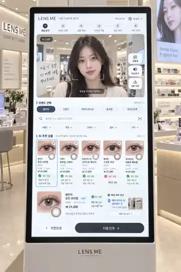

# LENS ME 디자인 가이드 v1.0

Version: 1.0.0
Updated: 2026-09-18
Owner: Ethan / Dex Company
Status: approved visual direction; proposed measurable implementation baseline
Applies to: LIVE kiosk, Android tablet, Android mobile
Classification: project design specification — 전역 Dex Skill로 자동 등록하지 않음

## 01. 시안의 승인 범위

에던이 승인한 현재 대화의 세로 키오스크 이미지를 시각 방향으로 삼아요. 기존 사용자 요구와 충돌하는 이미지 속 표현은 기능상 정정해요. 이 문서의 토큰·크기·세션 수치·구조 보정은 이미지에서 측정한 확정값이 아닌 구현 시작 제안이에요.

이미지는 방향 참조용이에요. 원본·변환 이력은 [REFERENCE_MANIFEST.json](REFERENCE_MANIFEST.json)에 기록해요. 이미지 자체를 클릭 영역이 덮인 앱 화면으로 쓰지 않아요. 컴포넌트·실제 텍스트·동작으로 다시 구현해요.

## 02. 디자인 정체성

**밝고 편안한 매장용 디지털 거울.** 주인공은 사용자의 자연스러운 모습이고 UI는 상품 비교를 도와요. 화이트/쿨그레이 표면, 차콜 CTA, 절제된 블루 상태 포인트, 얕은 그림자와 일정한 라운드를 사용해요. 화면보다 렌즈가 먼저 기억되게 해요.

| 유지 | 보정 | 제외 |
|---|---|---|
| 세로형 기기, 큰 LIVE, 밝은 표면 | 광고 모델 대신 생활형 상반신 LIVE | 얼굴 미용 보정·피부색 필터 |
| 브랜드 탭·검색·가로 상품 카드 | 실제 선택 브랜드와 상품 목록 일치 | 무의미한 AI 배지·확정형 얼굴 판정 |
| 차콜 핵심 버튼, 재고/위치 패널 | 재촬영 → 다시 맞추기/연결 복구 | 사진 업로드·셔터 중심 플로우 |
| 둥근 카드·부드러운 경계 | 가독성·터치 크기·문구 정확성 | 과한 네온·유리 효과·장식 그라데이션 |

## 03. 실제 사용하는 화면 구조

상단은 매장/솔루션·언어·도움말·종료, 중앙 상부는 큰 LIVE, 중하부는 브랜드/검색/상품, 하부는 선택 상품·재고·위치와 다음 행동이에요. 한 화면에 모든 상세정보를 영구적으로 펼치지 않아요.

6개 기능(얼굴 인식 준비/브랜드/상품/LIVE/재고/위치)은 모두 유지해요. 다만 선택 중 LIVE는 계속 보여주고 재고·위치는 직접 열 수 있게 해요. 스테퍼는 진행 안내이며 6회의 다음 버튼을 강제하지 않아요. MVP 표시는 `시작 → 체험·상품 찾기 → 선택 확인`의 3구간을 제안해요. 선택 확인 단계의 검수 전까지 기존 6단계 시안은 참조로 보존해요.

LIVE 위에 필기체 광고문구·상품 가격·큰 팝업을 겹치지 않아요. 제품 고르기를 방해하는 캠페인은 대기 또는 완료 화면으로 제한해요.

## 04. LIVE 연출과 카메라

머리 전체·양쪽 어깨·가슴 부근이 들어오는 생활형 상반신 프레이밍을 기본으로 해요. 자연스러운 옷차림·표정·자세를 허용하고 턱 괴기나 손으로 얼굴 만지기 같은 모델 포즈를 요구하지 않아요. 초기 세팅만 짧게 안내하고 정상 추적 중 얼굴 박스는 숨겨요.

전면 카메라 미리보기는 거울처럼 좌우 반전하되 UI 글자와 위치 안내는 반전하지 않아요. 원본 영상/추적/합성의 좌표 변환은 하나의 계약으로 맞춰요. 임의 확대·분할·원근 보정으로 얼굴을 왜곡하지 않아요. 피부·눈 크기·턱선은 바꾸지 않아요.

`LIVE`는 새 영상 프레임이 실제 갱신될 때만 켜요. 추적 준비중/렌즈 적용중/카메라 중단은 별도 상태예요. 얼굴이 프레임 밖으로 나가거나 눈을 감으면 렌즈 오버레이를 감추고 안전하게 재추적해요. 상반신과 눈 추적 해상도를 함께 만족하지 못하면 카메라/거리/렌더 전략을 조정하고 얼굴 확대를 강제하는 임시방편은 승인받아요.

## 05. 레이아웃·단위·반응형

키오스크 기준 디자인 프레임은 1080×1920의 9:16 세로 캔버스 제안이에요. 실제 기기의 해상도·inch·OS 배율이 확정됐다는 의미는 아니에요. 웹 수치는 CSS px, Android 수치는 dp/sp로 매핑하고 물리 px와 혼용하지 않아요. 아래 값은 브레이크포인트 판정 단위에 맞게 적용해요.

| 항목 | 세로 키오스크 | 태블릿 | 모바일 |
|---|---|---|---|
| 판단 기준 | kiosk 설정 + 충분한 가용 폭/높이 | 가용 폭 600 이상 중간 영역 | 가용 폭 600 미만 |
| 그리드 | 12열 | 8열 | 4열 |
| 바깥 여백 | 40~48 | 24~32 | 16 |
| 거터 | 24 | 20 | 12 |
| 최소 터치 영역 | 64×64 목표 | 48×48 이상 | 48×48 이상 |
| 주요 버튼 높이 | 72 | 56~64 | 52~56 |
| LIVE | 콘텐츠 높이의 약 38~45%에서 시작 | 세로 상부, 가로 약 60% 폭 | 상단 고정/제품 drawer 연동 |
| 상품 영역 | 카드 최소 폭 176; 4개 기본 | 가용 폭 기준 2~4개 | 2열 또는 목록 |

기기 이름만 보고 분기하지 않아요. 태블릿 가로는 LIVE/상품 60:40의 2열, 모바일은 LIVE와 바텀시트로 재배치해요. 전체 키오스크 화면을 작게 축소하지 않아요. 가상 키보드가 뜨면 검색 결과 영역이 보이게 재배치하고 선택/영상 상태를 보존해요. LIVE가 완전히 가려져 중단될 때에는 상태를 표시해요.

## 06. 컬러 토큰

값은 시안의 분위기를 유지하기 위한 제안이에요. UI 색을 변경해도 카메라 영상과 제품 발색에는 적용하지 않아요. 원본 사진의 픽셀을 스포이트로 읽은 확정값이 아니에요.

| 토큰 | 값 | 용도 |
|---|---|---|
| background | #F5F6F8 | 앱 바탕 |
| surface | #FFFFFF | 카드·입력·sheet |
| text.primary | #242A33 | 제목·상품명 |
| text.secondary | #586274 | 설명·보조 정보 |
| action.primary | #28313D | 주요 CTA |
| action.accent | #315DA8 | 선택 테두리·링크·focus |
| selection.background | #EDF3FC | 선택 카드 |
| border.subtle | #D9DFE8 | 장식 구분선 |
| border.control | #778395 | 입력/컨트롤 경계 |
| status.success | #176843 | 재고 있음 |
| status.warning | #855600 | 오래됨·확인 필요 |
| status.error | #B4232D | 오류·품절 |

일반 텍스트 대비는 4.5:1 이상, 큰 텍스트는 3:1 이상을 기준으로 검수해요(SRC-W1). 컨트롤/포커스는 배경과 식별되는 경계를 사용해요. 초록/빨강만으로 상태를 구분하지 않고 아이콘·텍스트를 함께 표시해요. 장식용 border.subtle을 입력 경계나 focus의 유일한 단서로 사용하지 않아요.

## 07. 타이포그래피

운영 글꼴 후보는 Noto Sans KR 계열이며 배포 전 실제 선택 폰트의 라이선스·로딩·한글/숫자 렌더링을 확인해요. 한 화면에 산세리프 1계열을 기본으로 사용하고 손글씨체 광고문구를 조작 화면에 넣지 않아요. PDF 설명 문서의 글꼴은 앱 폰트 확정과 별개예요.

| 역할 | 키오스크 크기/행간 | 모바일 크기/행간 | 굵기 |
|---|---|---|---|
| 주요 제목 | 32/44 | 24/34 | 700 |
| 섹션 제목 | 26/36 | 20/28 | 600 |
| 상품명/버튼 | 24/34 | 16/24 | 600 |
| 본문 | 22/32 | 16/24 | 400~500 |
| 보조 정보 | 18/28 | 14/21 | 400~500 |

한국어 단어 단위 줄바꿈을 우선해요. 상품명은 최대 2줄, 말줄임 시 상세에서 전체 이름을 볼 수 있게 해요. 상품코드는 자동 글자 축소 대신 별도 줄/확장으로 보여요. 가격과 재고 수량은 숫자 정렬을 일정하게 맞춰요. 핵심 상품명·가격·재고·버튼을 읽을 수 없게 축소해 한 화면에 넣지 않아요.

## 08. 간격·형태·아이콘

간격은 4/8/12/16/24/32/40/48, 기본 리듬은 8이에요. 카드 내부 20~24, 관련 요소 8~12, 섹션 간 24~32를 시작값으로 해요. 카드 반경 20, 입력 14, 버튼 16, 상태 pill만 999예요. 모든 것을 pill로 만들지 않아요. 그림자는 `0 4px 16px rgba(24,36,54,0.06)` 한 단계만 기본 적용해요.

아이콘은 한 세트, 동일 stroke(24 grid 기준 1.75~2), 같은 정렬을 사용해요. 실제 기능이 없는 카메라·바코드·다운로드 아이콘은 제거해요. 사진 프리뷰와 렌즈 상품 썸네일의 종횡비·crop 규칙을 토큰화해요.

## 09. 주요 컴포넌트

| 컴포넌트 | 필수 정보/상태 | 동작 |
|---|---|---|
| LiveStage | LIVE/준비/중단, 현재 적용 상품 | 영상 유지, 추적 유실 시 안전한 overlay 제거 |
| BrandTabs | 전체/브랜드, selected, focus | 선택 범위로만 상품 출력; 검색어 보존 |
| ProductSearch | 명시 label + placeholder, clear, scope | 제품명/상품코드, IME 완료 후 검색 |
| ProductCard | DEMO/브랜드·이름·코드·색·선택 | 탭 즉시 선택 표시; 적용 성공 후 착용 중 |
| TryOnSwitch | 맨눈/렌즈, disabled 이유 | 전체 얼굴 양쪽 눈 동시 전환 |
| StockPanel | 옵션·매장·상태·확인시간 | 선택 옵션 없으면 수량 확약 금지 |
| LocationPanel | 매장/구역/진열대/단/코드 | 텍스트 기본, 검증된 지도만 확장 |
| BottomActions | 다음 행동 1개 + 보조 1개 | 선택 확인 또는 직원에게 보여주기 |
| SessionNotice | 남은 시간, 계속 체험/종료 | 경고 후 세션 정리, 접근성 검수 |

카드 전체 선택과 하트/비교 버튼을 중첩 처리하지 않아요. 보조 버튼 터치가 상품 선택으로 전파되지 않게 해요. 재고 없음이어도 체험 가능 여부는 별도 정책으로 구분해요.

## 10. 상태·오류·문구

| 상태 | 화면 문구 예시 | 복구/제약 |
|---|---|---|
| 카메라 준비 | 카메라를 연결하고 있어요 | 상품 둘러보기 유지 |
| 권한 거절 | 카메라 권한이 필요해요 | 권한 안내/상품만 보기 |
| 얼굴 없음 | 얼굴과 어깨가 화면 안에 보이도록 서 주세요 | 자동 재추적 |
| 다중 얼굴 | 한 분씩 체험해 주세요 | 합성 중지 |
| 추적 유실 | 눈 위치를 다시 확인하고 있어요 | 잘못된 overlay 금지 |
| 렌즈 로드 오류 | 렌즈를 적용하지 못했어요 | 이전 적용 유지/다시 시도 |
| 검색 없음 | 이 브랜드에서 검색된 상품이 없어요 | 검색어 수정/전체 브랜드 검색 |
| 재고 지연 | 재고를 다시 확인해 주세요 | 마지막 확인시각/새로고침 |
| 재고 오류 | 현재 재고를 확인할 수 없어요 | 직원 문의; 품절로 표시 금지 |
| 위치 미등록 | 상품 위치를 직원에게 문의해 주세요 | 임의 위치 생성 금지 |
| 세션 경고 | 체험을 계속하시겠어요? | 계속 체험/종료 |
| 영상 중단 | 카메라 연결이 중단됐어요 | LIVE badge off/연결 복구 |

상태는 문제와 다음 행동을 짧게 알려줘요. 기술 오류 코드·장문의 Alert·확인 버튼 반복을 고객에게 떠넘기지 않아요. 합성 결과는 실제 착용과 다를 수 있다는 안내를 읽을 수 있게 제공하되 화면을 상시 가리지 않아요.

## 11. 인터랙션

선택 피드백은 100ms 이내 목표, 색/테두리 전환은 120~180ms, sheet는 180~240ms 제안이에요. 이 수치는 성능 측정 결과가 아니에요. 렌즈 변경 중 카메라를 다시 열지 않아요. 과장된 카드 뜀·튕김·자동 carousel·반복 shimmer는 사용하지 않아요. reduced motion을 지원하고 터치 조작에 hover를 필수로 쓰지 않아요.

검색/정렬/브랜드 변경은 상품 영역만 갱신해요. 전체 화면 refresh·최상단 점프를 하지 않아요. 가로 카드 목록이 필요하면 swipe 외에도 앞/뒤 버튼과 현재 범위를 제공해요. 주요 UI를 64 touch target으로 맞추고 카드 개수를 줄이는 쪽을 우선해요.

## 12. 이미지·브랜드·콘텐츠

운영 상품 이미지는 브랜드 승인 이미지/렌즈 asset만 사용해요. 생성 이미지 속 상품명을 그대로 실제 catalog에 넣지 않아요. 개발 DEMO는 `DEMO A/B/C` 같은 가상 브랜드와 상품을 써서 실브랜드의 판매 정보로 오인하지 않게 해요. 로고 사용 권한, 가격, 상품코드, 발색, 재고는 각각 별도 확인 대상이에요.

얼굴·손·눈 구조 오류, 좌우 렌즈 불일치, 흰자 착색, 동공 덮임, 눈꺼풀 위 패턴, 하이라이트 소실, 텍스트 깨짐을 검수해요. 실제 고객 영상은 합성/추적을 위해 일시 처리하고 얼굴 이미지가 디자인 검수 파일이나 로그에 무심코 저장되지 않게 해요. QA용 촬영이 필요하면 승인된 별도 절차와 보존 범위를 먼저 정해요.

## 13. 접근성·매장 조건

Android touch target 48×48dp 권고(SRC-W2), 웹 WCAG 2.2 최소 target 기준(SRC-W4)을 참고하되 본 키오스크는 64×64 목표를 적용해요. 이는 현장 물리 크기와 도달성 검증을 대체하지 않아요. 서 있는 사용자뿐 아니라 앉은 사용자, 작은 키, 큰 글씨, 휠체어 접근, 역광·반사, 조명과 사용 거리도 실제 하드웨어에서 확인해요.

키보드/보조기기 focus 순서, 버튼 접근 가능한 이름, 확대/큰 글씨에서 reflow, 색 외 상태 단서, 한국어/추가 언어의 확장을 확인해요. 음성 안내/이어폰·물리 높이 등 무인단말기 요구는 설치 시장/매장 사양 확정 후 별도 접근성 Gate로 검토해요. WCAG 일부 검수로 법적 접근성 인증 완료를 선언하지 않아요.

## 14. 수정과 검수 기준

대표 화면 1개를 코드로 구현한 뒤 기준 이미지와 정보 위계·간격·글자·도달성·실제 상태를 대조해요. 승인 이미지가 매장 사진이므로 원근/기기 테두리까지 raw pixel diff하지 않아요. 이후 동일 viewport·동일 DEMO·고정 synthetic 프레임으로 승인한 구현 screenshot baseline을 만들어 회귀 검사해요. 실제 LIVE 동작은 별도로 검증해요.

P0 결함은 진행 차단, 화면 겹침/주요 문구 절단, 잘못된 렌즈/재고/매장, 이전 고객 정보 노출, 멈춘 영상의 LIVE 표시예요. P0가 남으면 다음 확장/출시 Gate로 넘기지 않아요. 검수자는 작성과 분리한 review run을 사용하고 독립 검수가 실행되지 않으면 Not Checked로 남겨요.

세부 테스트는 [QA_ACCEPTANCE.md](../QA_ACCEPTANCE.md), 제품 정의는 [PRODUCT_SPEC.md](../PRODUCT_SPEC.md), 출처는 [SOURCES.md](../SOURCES.md)를 사용해요. 반경·색상·폰트·레이아웃을 임의 변경하지 않고 버전/변경 이유/영향 화면/검수 결과를 DECISIONS와 CHANGELOG에 남겨요.
