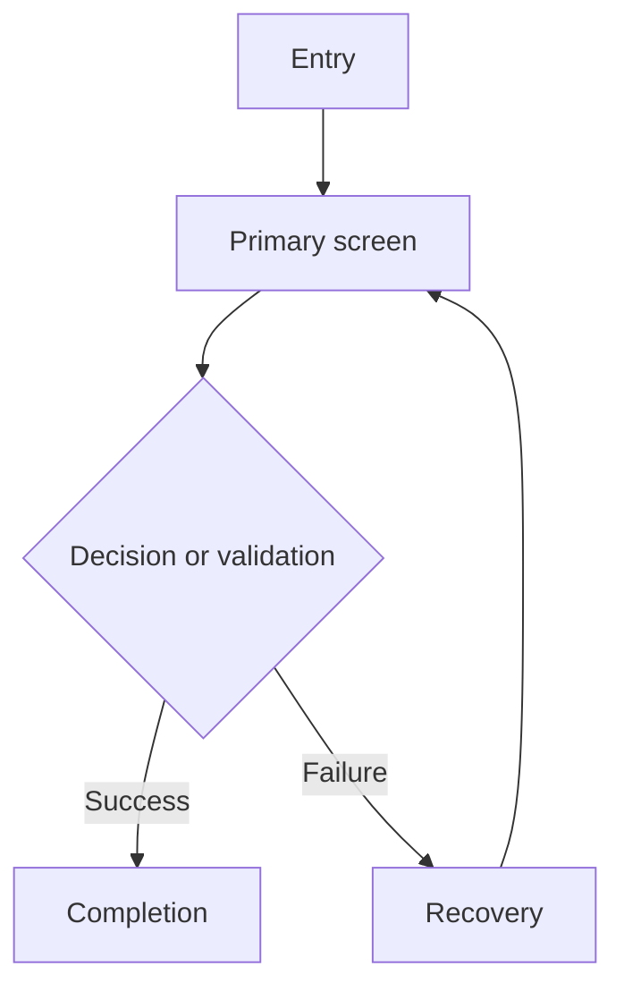

> Markdown fallback only: use this template when no approved project screen-spec profile or established artifact exists and the requested format is Markdown or unspecified. If the user provides another Markdown structure, follow it. Do not convert an established PPTX, Figma, spreadsheet, or other template into this structure by default. Template IDs are provisional until an approved project ID policy registers them.

# SCREEN_SPEC

- Project: `<project>`
- Feature: `<feature>`
- Version: `<version>`
- Updated: `<YYYY-MM-DD>`
- Status: Draft
- Canonical sources: `<links or paths>`

## 1. Objective and scope

### Objective

`<user and business outcome>`

### Target users and channels

- Users: `<users>`
- Channels: `<PC / Mobile / Responsive / App>`

### Included

- `<included scope>`

### Excluded

- `<excluded scope>`

## 2. Evidence and policy status

| ID | Type | Statement | Status | Source/Owner |
|---|---|---|---|---|
| RQ-001 | Requirement | `<requirement>` | confirmed | `<source>` |
| POL-001 | Policy | `<policy>` | confirmed | `<source>` |
| Q-001 | Open decision | `<question>` | open | `<owner>` |

## 3. User journey

## 4. Screen inventory

| Screen ID | Screen name | Type | Channel | Purpose | Entry | Exit |
|---|---|---|---|---|---|---|
| SCR-001 | `<name>` | Page | PC/Mobile | `<purpose>` | `<entry>` | `<exit>` |

## 5. Screen details

### SCR-001 — `<screen name>`

#### Purpose and conditions

- Purpose: `<purpose>`
- Entry conditions: `<conditions>`
- Exit/completion: `<result>`
- Confirmed policy: `<confirmed>`
- Proposal: `<proposal or none>`
- Open decisions: `<IDs or none>`

#### Layout and components

| Element ID | Region/element | Type | Condition | Content/value | Action | Result |
|---|---|---|---|---|---|---|
| EL-001 | `<element>` | `<type>` | `<condition>` | `<value>` | `<action>` | `<result>` |

#### Fields and validation

| Field ID | Field | Required | Default | Format/limits | Validation timing | Validation/message ID | Result |
|---|---|---:|---|---|---|---|---|
| FLD-001 | `<field>` | Y/N | `<default>` | `<rules>` | `<timing>` | VAL-001 | `<result>` |

#### Validation and message evidence

| Validation/message ID | Screen/element | Type, condition, and timing | Rule source/status | Exact literal | Literal source/status | Button roles and outcomes |
|---|---|---|---|---|---|---|
| VAL-001 | SCR-001 / FLD-001 | `<Inline / Alert / Confirm; condition; timing>` | `<source or open ID> / <status>` | `<quoted literal or TBD>` | `<source or open ID> / <status>` | `<roles; confirm/cancel/failure results>` |

#### Actions and navigation

| Action ID | Trigger | Enabled condition | Processing state | Success | Failure/recovery |
|---|---|---|---|---|---|
| ACT-001 | `<trigger>` | `<condition>` | `<loading/lock>` | `<destination/feedback>` | `<recovery>` |

#### State and exception matrix

| State | Condition | UI behavior | Allowed action | Recovery/result |
|---|---|---|---|---|
| Initial | `<condition>` | `<behavior>` | `<action>` | `<result>` |
| Loading | `<condition>` | `<behavior>` | `<action>` | `<result>` |
| Empty | `<condition>` | `<behavior>` | `<action>` | `<result>` |
| Error | `<condition>` | `<behavior>` | `<action>` | `<result>` |
| Offline | `<condition>` | `<behavior>` | `<action>` | `<result>` |
| Disabled | `<condition>` | `<behavior>` | `<action>` | `<result>` |
| Session expired | `<condition>` | `<behavior>` | `<action>` | `<result>` |
| Duplicate submit | `<condition>` | `<behavior>` | `<action>` | `<result>` |

#### Responsive and accessibility

- PC: `<layout and interaction>`
- Mobile: `<layout and interaction>`
- Focus order: `<order>`
- Semantic labels/states: `<labels>`
- Touch targets and keyboard: `<rules>`
- Contrast, text resize, motion: `<rules>`

#### Dependencies

- Data/content: `<dependency>`
- API/spec: `<reference>`
- External provider: `<reference>`
- Analytics: `<approved event reference or not applicable>`

#### Acceptance criteria

- AC-SCR-001-01 — Given `<condition>`, when `<action>`, then `<observable result>`.
- AC-SCR-001-02 — Given `<failure condition>`, when `<action>`, then `<recovery result>`.

## 6. Traceability

| Requirement | Policy/decision | Screen/element | Acceptance criteria | Status |
|---|---|---|---|---|
| RQ-001 | POL-001 | SCR-001 / EL-001 | AC-SCR-001-01 | covered |

## 7. Artifact dependencies

| Artifact | Purpose | Status | Link/path |
|---|---|---|---|
| SPEC.md | API and technical behavior | `<status>` | `<path>` |
| DATA_MODEL.md | Data entities and persistence | `<status>` | `<path>` |
| QA artifact | Executable test cases/results | `<status>` | `<path>` |

## 8. Verification

### PASS

- `<verified item>`

### FAIL

- `<failed gate or none>`

### Not Checked

- `<unverified item>`

## 9. Remaining decisions and handoff

- Open decisions: `<IDs and owners>`
- Changed scope: `<files/sections>`
- Preserved scope: `<files/sections>`
- Minimum next action: `<action or none>`
